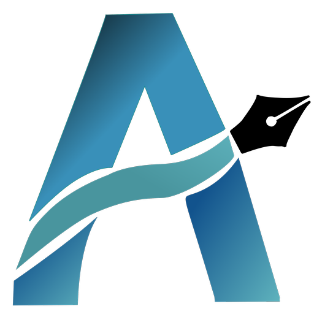
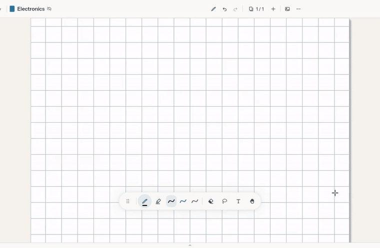
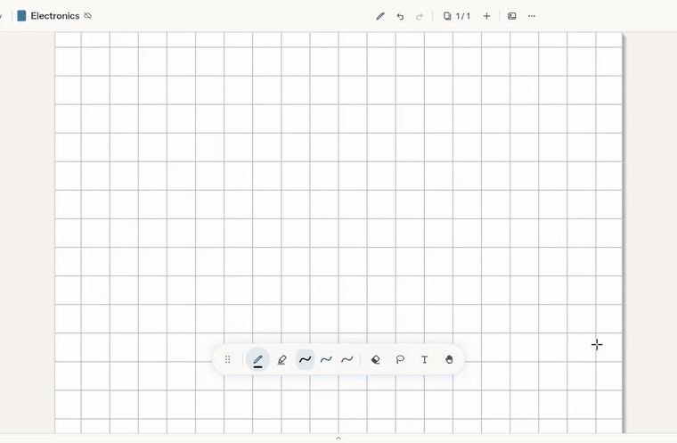
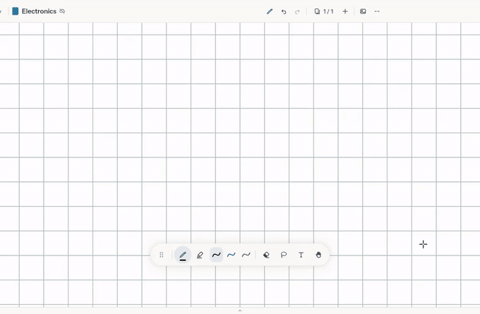
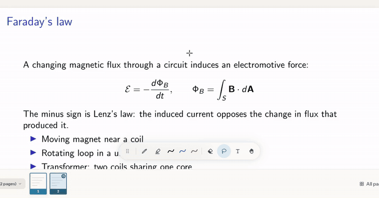

<div align="center">



# AbelNotes

**Handwritten notes for people who write equations.**
Cross-platform, self-hostable, open source. Your notes sync to a place *you* control: your own WebDAV/Nextcloud server, or your own Google Drive. Never through a cloud we run.

**[Try it in your browser →](https://app.abelnotes.app)**. Nothing to install, no account.

[](LICENSE)

[](https://github.com/sponsors/abelnotes)

</div>

---

<div align="center">

</div>

---

## What makes it different

**1. It reads your math and your circuits.**
Lasso a handwritten formula and it becomes editable LaTeX. Lasso a hand-drawn circuit, or pick a photo of one, and it comes back with clean symbols and straight wires. Both run on your device, nothing is uploaded *(Beta, free while in testing)*.

**2. Your notes, your server, every device.**
Sync through your own Nextcloud or any WebDAV server, or your own Google Drive. Never through a cloud we run. Windows, Linux, Android and the web today, offline-first, with real merging when two devices edit the same page.

**3. Bring your notes with you.**
Import OneNote sections, Samsung Notes files, Notion exports, Obsidian vaults and PDFs. On a fresh install the library offers it in one tap.

**4. Draw it once, reuse it everywhere.**
Freehand lines, circles and arrows straighten into clean shapes, and anything you draw can be saved as a symbol and dropped onto any page.

**5. A sketchbook and a bookshelf in one app.**
Infinite canvases for thinking, paged notebooks with chapters for keeping things in order, side by side in the same library.

And it is **open source (AGPL-3.0)**: read exactly how your notes are handled, build it yourself for free, or grab a store build to support development.

---

## Features

**Math and circuits**
- **Formula recognition** *(Beta, free while in testing)*: lasso a handwritten formula and tap Recognize. It becomes typeset LaTeX you can edit. Recognition runs on your device, in the web app too, and nothing is uploaded. Check the result: one undo brings the ink back. Turn it off in Settings → Modules
- **Circuit recognition** *(Beta, free while in testing)*: lasso a hand-drawn circuit and tap Recognize, or use the ⋯ menu of a photo of one, and it is redrawn with clean symbols and straight wires on your device. Nothing is uploaded, in the web app too; turn it off in Settings → Modules
- **LaTeX math**: paste LaTeX or Markdown (from your notes, a paper or an AI assistant) and it becomes typeset math, sharp at any zoom, that you move and annotate like ink
- Both recognisers are part of the open-source code (AGPL-3.0): building from source, and the Flatpak, AUR and GitHub builds, always include every feature

<div align="center">

</div>

**Sync and offline**
- **Local-first**: everything works offline; changes sync when you reconnect
- **Two backends, your pick**: your own WebDAV/Nextcloud server, or your own Google Drive, one at a time, switchable
- **Real conflict handling**: element-level 3-way merge, so two devices writing on the same page keep each other's strokes, with a resolution screen when edits genuinely diverge
- **Delta sync**: only changed pages and assets are uploaded, not the whole notebook
- **Per-notebook opt-out**: any notebook can be kept on this device only, never uploaded, while the rest keep syncing
- **Per-device opt-out**: a notebook can be taken off one device without leaving the account; opening it downloads it again
- Deleted notebooks go to the trash on every device and can be restored from any of them
- Connection pooling tuned for real self-hosted setups (including flaky Tailscale links)

**Import**
- **OneNote** sections and notebooks (desktop)
- **Samsung Notes** files (.sdocx): handwriting with its colours, typed text and pictures (text positions approximate)
- **Notion** exports and **Obsidian** vaults (Markdown) *(implemented, not yet tested against real exports)*
- **PDF** with rasterized pages *and* selectable embedded text, annotated with the normal tools
- Drop files on the library (desktop) or open them with AbelNotes (Android)

**Drawing**
- Multiple pen types (pen, ballpoint, brush, calligraphy) with pressure-driven variable stroke width, plus quick pens in the dock
- Shape recognition: freehand lines, circles, rectangles and arrows snap to clean geometry
- **Symbol library**: save anything you drew as a reusable symbol
- Highlighter whose overlapping strokes read as one mark, lasso select, palm rejection and stylus-only mode
- Laser pointer for presenting (not saved to the page)

<div align="center">

</div>

**Notebooks and canvases**
- Infinite "Sketch" canvases and paged notebooks with chapters, in one library with folders and favourites
- **8 paper types**, including Cornell, isometric and music staff, switchable after you've started writing
- Open another notebook beside the one you are editing (desktop)
- The tool dock can float, stick to an edge or sit inside the top bar

**Sharing**
- Read-only public links via a PDF snapshot (Nextcloud OCS Share API), with real revocation
- Export to PDF with real vector ink and selectable text

---

## PDF import

<div align="center">

</div>

---

## Download

Grab the latest build from the [**Releases**](../../releases) page:

- **Web**: https://app.abelnotes.app, right in the browser: nothing to install, works offline once loaded, and can be added to the home screen on iPhone and iPad. Syncs with Google Drive; syncing with a WebDAV server from the browser needs that server to allow requests from app.abelnotes.app (CORS).
- **Windows**: [Microsoft Store](https://apps.microsoft.com/detail/9nl7fk76t2fv)
- **Linux**: Flatpak with automatic updates: https://abelnotes.github.io/flatpak/ (one click in GNOME Software, KDE Discover or the Mint Software Manager), or the `.deb` from Releases
- **Android**: [Google Play](https://play.google.com/store/apps/details?id=app.abelnotes.notes)
- **iPadOS / macOS**: working build, tested on real hardware, but not distributed yet: signing and shipping it needs the paid Apple Developer Program ($99/year), which is what [sponsoring](https://github.com/sponsors/abelnotes) is for. Meanwhile the web app runs on both.

---

## Security & privacy

Short version, being honest rather than impressive:

- WebDAV connections use TLS with **certificate pinning** (trust-on-first-use). A certificate change without re-authenticating fails the connection instead of silently trusting it.
- Your Nextcloud password is stored in the OS secure keystore (Keychain / Android Keystore / DPAPI / Secret Service), never in plain prefs.
- Google Drive sync asks for the **`drive.file` scope only**: the app can see and manage the files it created, and nothing else in your Drive. No password reaches the app: mobile hands the tokens to the platform, desktop keeps a refresh token in the same OS keystore as the WebDAV password.
- **Notebook content is not encrypted at rest.** It's plain JSON/ZIP, on-device and on your server. End-to-end encryption is on the roadmap, not yet built.
- Known gap: headless Linux with no Secret Service daemon falls back to storing the credential in plaintext.

Full details and known limitations: see [SECURITY.md](SECURITY.md).

---

## Building from source

Requires the [Flutter SDK](https://docs.flutter.dev/get-started/install).

```bash
git clone https://github.com/abelnotes/abelnotes.git
cd abelnotes
flutter pub get

# Desktop only, once per machine (see the note below)
flutter config --enable-native-assets

# Run
flutter run

# Build
flutter build apk        # Android (.apk)
flutter build appbundle  # Android (.aab, for Play)
flutter build linux      # Linux
flutter build windows    # Windows
```

**`--enable-native-assets` is not optional for desktop builds.** PDF support
comes from pdfrx, which ships PDFium as a native asset rather than as a CMake
plugin: it is listed in neither `windows/flutter/generated_plugins.cmake` nor
`linux/flutter/generated_plugins.cmake`. Without the flag the build still
succeeds and PDFium is simply absent from the bundle, so every PDF fails once
the app is already running. Confirmed by building on Windows; Linux is wired the
same way.

Rust is **not** required for a normal build. The OneNote import bridge is
committed prebuilt for Windows and Linux under `native/prebuilt/`; you only need
a Rust toolchain to rebuild it yourself with `native/build_onenote_bridge.sh`.

### Documentation

- [ARCHITECTURE.md](ARCHITECTURE.md): how the app is put together and why
- [ABELNOTE_FORMAT_GUIDE.md](ABELNOTE_FORMAT_GUIDE.md): the notebook format on disk, file by file
- [SECURITY.md](SECURITY.md): threat model, encryption, how to report a vulnerability

---

## Support the project

AbelNotes is free and has no ads, accounts or tracking. If it's useful to you, you can support its development on [GitHub Sponsors](https://github.com/sponsors/abelnotes). The current goal is covering the Apple developer fee, so AbelNotes can ship on iOS and macOS.

---

## Contributing

Contributions are welcome. Before your first pull request, read [CONTRIBUTING.md](CONTRIBUTING.md): contributors sign the [Contributor License Agreement](CLA.md) once (you keep your copyright; it lets the project publish AbelNotes in app stores too) and sign off their commits under the [Developer Certificate of Origin](https://developercertificate.org/) (`git commit -s`).

Good first areas: testing experimental WebDAV backends against real servers (Seafile, Synology, generic WebDAV), import edge cases, and platform-specific polish.

---

## License & trademark

Source code is licensed under **AGPL-3.0-or-later**, see [LICENSE](LICENSE).

**"AbelNotes" and the AbelNotes logo are *not* covered by the AGPL license.** They are protected separately, see [TRADEMARK.md](TRADEMARK.md). In short: build and modify the code freely, but if you redistribute publicly, use a different name and icon. This mirrors common practice (e.g. Firefox/Iceweasel, Chromium/Chrome).

Third-party dependencies and their licenses are listed in [ACKNOWLEDGMENTS.md](ACKNOWLEDGMENTS.md).

---

<div align="center">
Made by Joy · <a href="https://abelnotes.app">abelnotes.app</a>
</div>
